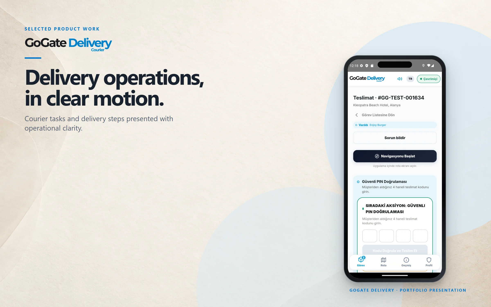
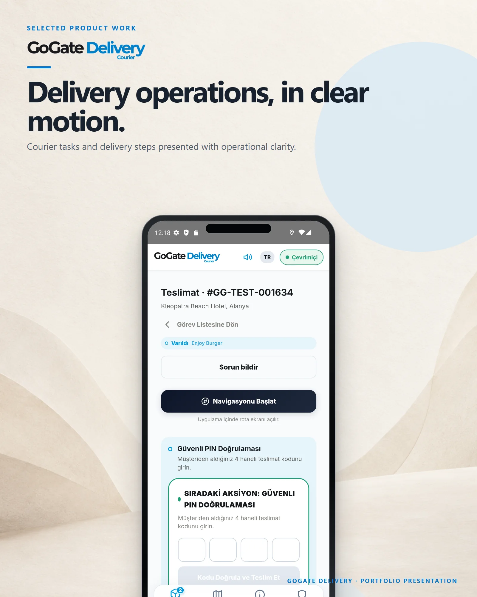

# GoGate Delivery

Delivery operations for restaurants, hotels and resorts — orders, couriers, tasks and collections managed in one flow.

**Live:** [gogatedelivery.com](https://gogatedelivery.com) &nbsp;·&nbsp; **More work:** [github.com/mertomeroglu](https://github.com/mertomeroglu)

### Highlights

- One flow from order to delivery: create, assign, track, complete
- Courier app with the active task, in-app navigation and secure PIN handover
- Live courier and task status for operations teams
- Collections, receipts and delivery proof matched to each order
- Built for room service, takeaway and on-site delivery

### Built with

ASP.NET Core · Entity Framework Core · PostgreSQL / PostGIS · Redis · SignalR · React · Vite · TypeScript · Tailwind CSS · Capacitor · Docker

---

Presentation-only repository: this README and two presentation images built from real product screens. Application source and private configuration are not published here. Visual content and brand assets remain the property of their respective owners — see [LICENSE](LICENSE).
