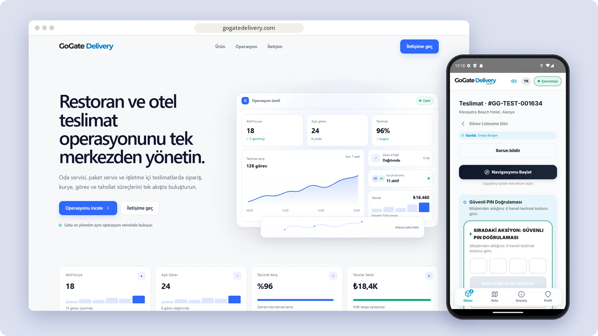
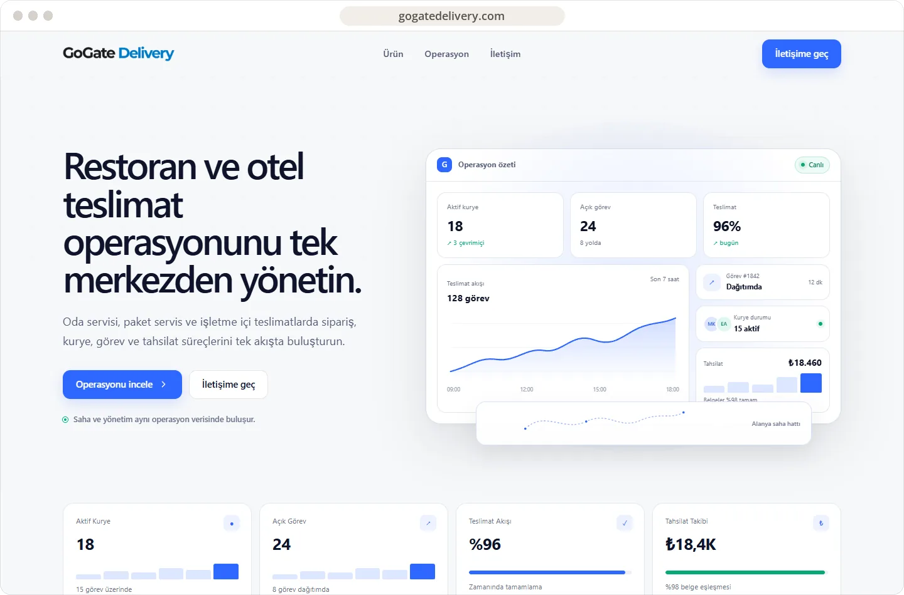
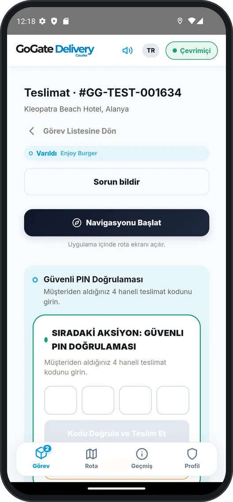

# GoGate Delivery

Delivery operations for restaurants, hotels and resorts — orders, couriers, tasks and collections managed in one flow.

**[Visit gogatedelivery.com ↗︎](https://gogatedelivery.com)** &nbsp;·&nbsp; [More work by Mert Ömeroğlu](https://github.com/mertomeroglu)

### Highlights

- One flow from order to delivery: create, assign, track, complete
- Courier app with the active task, in-app navigation and secure PIN handover
- Live courier and task status for operations teams
- Collections, receipts and delivery proof matched to each order
- Built for room service, takeaway and on-site delivery

### Built with

ASP.NET Core · Entity Framework Core · PostgreSQL / PostGIS · Redis · SignalR · React · Vite · TypeScript · Tailwind CSS · Capacitor · Docker

### Screens

---

Presentation-only repository. Images are real, unmodified product screens in a simple frame; application source and private configuration are not published here. Brands and visual content belong to their respective owners — see [LICENSE](LICENSE).
